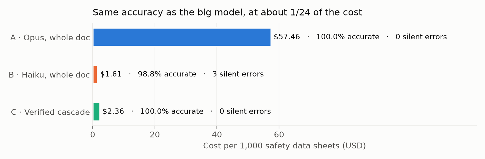
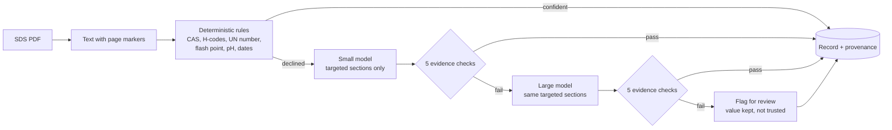
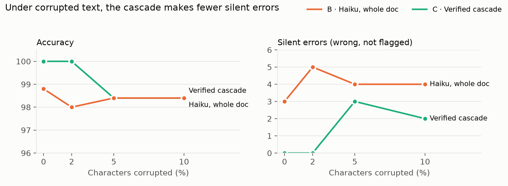
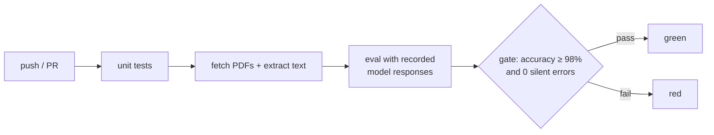

# spec-extraction-eval

**Extracting product attributes from messy safety data sheets, cheaply, with every value checked before it's trusted.**

[](https://github.com/manishreddy998/spec-extraction-eval/actions/workflows/eval.yml)

Product data comes from PDFs: spec sheets, catalogs, safety data sheets (SDS). The easy way to extract it is to send every
document to the biggest model available. That works, but it costs the full document length in tokens every time, and when the
model is wrong, nothing says so.

This project compares three ways to pull 10 attributes out of 25 real SDS PDFs. It measures more than accuracy: it also counts
**silent errors**, meaning wrong values that the pipeline would have passed on as correct.



| | A · Opus, whole document | B · Haiku, whole document | **C · Verified cascade** |
|---|---|---|---|
| Accuracy (250 values) | 100.0% | 98.8% | **100.0%** |
| Silent errors | 0 | 3 | **0** |
| Flagged for human review | none (no checks) | none (no checks) | 6 |
| Input tokens | 334,632 | 334,632 | **75,893** |
| Cost per document | $0.0575 | $0.0016 | **$0.0024** |
| Median model time per document | 2.7s | 2.9s | **1.7s** |

The verified cascade matches the large model on every field at **about 1/24 of the cost**. It also does something
neither single-model method can do: it says which values it can't vouch for.

## How the cascade works



1. **Rules first, and they're allowed to say "I don't know."** Fields with a fixed shape get regex rules that know the domain.
   CAS numbers carry a check digit, so the rule validates it. GHS hazard codes come only from Section 2. A rule **declines**
   instead of guessing when it sees lookalike characters (`H3l9`, `6B-64-1`), a range, or a section whose end it can't find.
   On clean documents the rules answer 171 of 200 eligible values with 0 errors, for free.
2. **Only what's missing goes to a model, and only the relevant sections.** Each field maps to the GHS section its answer
   lives in. The small model sees Section 1, page 1 and those sections, not the whole 30,000-character document. That's where
   most of the 4.4× token reduction comes from.
3. **Every model answer must cite its evidence.** The schema asks for `{value, quote}` per field, and five deterministic checks
   decide whether to trust it:

| Check | Catches |
|---|---|
| **Grounding**: the quote exists in the source text | invented evidence |
| **Consistency**: the value can be read out of its own quote (unit-aware, date-format-aware) | `-29.2` copied from `<-29.2°F` without converting; `02/12/2025` read as 2 December |
| **Validity**: domain rules (CAS check digit, GHS code ranges, plausible dates and pH) | malformed or impossible values |
| **Clean source**: no corrupted characters in a numeric quote | a model "reading through" `-1B.8` and guessing |
| **Honest nulls**: a "not stated" answer can't quote a line that states a value | `null` for physical state while quoting `Liquid ...` |

4. **Failures escalate once, then get flagged.** A value that fails goes to the large model with the same targeted context.
   If it fails again, it's kept but marked `review`, with the failed checks attached. Every output field records which stage
   produced it, the model, the quote, and the checks it passed.

## Three things that went wrong, and what they taught me

**1. My own golden set was wrong, and the pipeline caught it.** One PDF (`sds_08`) has a broken font map: "n" renders as "m",
"7" as "B", so acetone's CAS number `67-64-1` comes out of the text layer as `6B-64-1`. I had drafted labels with help from
regexes, and only 3 of the 9 ingredients matched. The model read all 9 correctly, and checking the PDF confirmed it. Lesson:
labels must come from the source document, not from the same text layer the extractor sees
([labeling guide](docs/labeling_guide.md)).

**2. On that same document, the cascade flagged exactly the fields it shouldn't trust.** The small model's answers for
manufacturer, CAS numbers, signal word and flash point all quoted corrupted text (`CRC Imdustries, Imc.`, `Damger`,
`-1B.8`). They escalated, failed again because the source itself is broken, and came out marked for review. Three of the four
values were right, but nothing in the text proves it, so flagging them is the honest answer.

**3. The rules were the weakest link under stress, because they were trusted without checks.** I built a
[stress test](scripts/stress_test.py) that applies the same kind of character corruption to every document at 2%, 5% and 10%.
The first run made the cascade look *worse* than plain Haiku. The cause: when `H319` became `H3l9`, the strict pattern simply
skipped it, and the rule returned an incomplete list with full confidence. Corrupted section headings also let Section 2 run
into the ingredient table. The fix was to make the rules corruption-aware: they count lookalike tokens and decline when they
see them, and they require both ends of a section. After the fix the rules make 0 errors at every corruption level, and they
hand over more fields as the text degrades.



| Corruption | B · Haiku: accuracy / silent errors | C · Cascade: accuracy / silent errors / flagged |
|---|---|---|
| 0% | 98.8% / 3 | 100.0% / 0 / 6 |
| 2% | 98.0% / 5 | 100.0% / 0 / 18 |
| 5% | 98.4% / 4 | 98.4% / 3 / 39 |
| 10% | 98.4% / 4 | 98.4% / 2 / 51 |

At heavy corruption both methods are about equally accurate. The cascade makes fewer silent errors, flags far more values
for review, and costs more because escalations go to the large model. The remaining silent errors are small-model answers
whose evidence looks clean but is incomplete, for example a hazard code that sits on a different line from the quote. That's
the next thing to work on (see below).

## Evals on every push



Every model call is stored under a hash of its full request in [`cache/llm/`](cache/llm). CI runs the whole eval in replay
mode, with no API key and no cost, in under a minute. If a change to a prompt, schema, rule or check alters a request, the
cache misses and CI fails. That's intended: re-record with a real run, look at the new numbers, then commit them together.

## Run it

```bash
python -m venv .venv && source .venv/bin/activate
pip install -r requirements.txt
cp .env.example .env              # add ANTHROPIC_API_KEY (not needed for replay)

python scripts/download.py        # 25 public SDS PDFs (not redistributed here)
python scripts/extract_text.py
python scripts/run_eval.py        # all three methods; replays recorded responses if present
python scripts/stress_test.py     # robustness curve
python scripts/make_charts.py
python -m pytest -q tests
```

Replay only (free): `SPECX_CACHE=replay python scripts/run_eval.py --gate`. Results also land in `results/eval.duckdb`
(one row per method × document × field), so failures can be sliced with SQL.

## Repository layout

```
src/specx/
  schema.py           the 10 attributes (Pydantic) - single source of truth for every method
  pdf_text.py         PDF -> text with page markers
  sections.py         finds GHS sections despite inconsistent headings
  rules.py            deterministic extractors that decline when unsure
  targeted.py         field -> section routing; {value, quote} evidence schemas
  evidence.py         the five trust checks
  extract_single.py   methods A and B
  extract_cascade.py  method C
  llm.py              Messages API wrapper: structured outputs, cost tracking, response cache
  score.py            per-field scoring (fuzzy names, exact codes, numeric tolerance, set match)
scripts/              download, text extraction, eval runner, stress test, charts, labeling helper
data/                 manifest of sources + golden labels (PDFs and text are git-ignored)
results/              summary tables and robustness data
```

## Limits, honestly

- **25 documents, 7 manufacturers.** That's enough to compare methods and find failure modes, not to claim production
  accuracy. The golden labels were drafted from the PDFs and are being checked line by line (`verified` flag per record).
- **The corruption is synthetic.** It's modelled on the real broken font map in `sds_08`, but real OCR noise is messier.
- **Model outputs vary between runs.** Haiku's three misses moved from one field to another across runs. Recorded responses
  make each run reproducible; they don't make the model deterministic.
- **The flag rate is conservative.** At 10% corruption, 51 values are flagged and only 2 of them are actually wrong. Precision of
  the flags is the next metric to improve.

## What I'd do next

- **Cross-field checks:** every H-code in Section 2 should be supported by an ingredient in Section 3, and an aerosol
  (`UN1950`) should carry H222 or H223. These catch omissions that single-quote evidence can't.
- **Batch and cache at scale:** the Message Batches API halves the cost of non-urgent extraction, and the system prompt
  plus schema are identical across documents, so they can be cached.
- **Load into BigQuery** with lineage back to the source page, and track accuracy per manufacturer layout over time.
- **More document types:** spec sheets and catalogs, where entity resolution across suppliers becomes the hard part.
